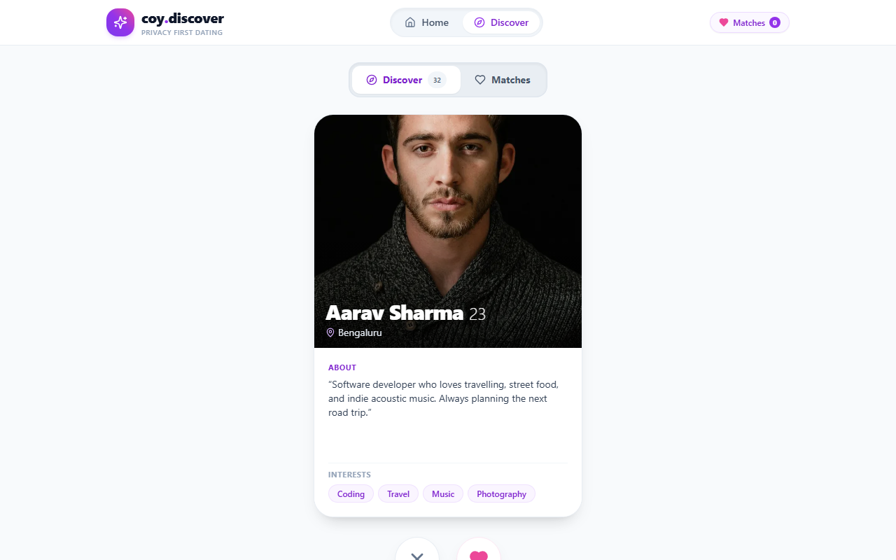
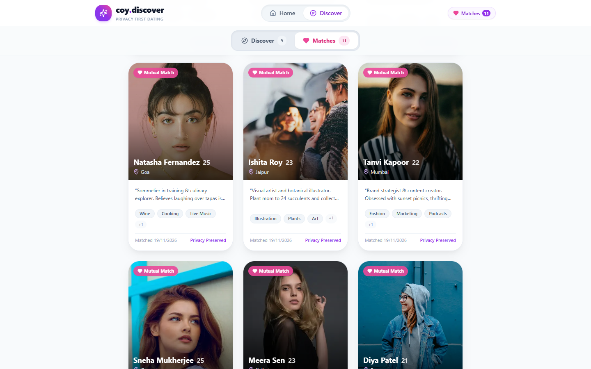
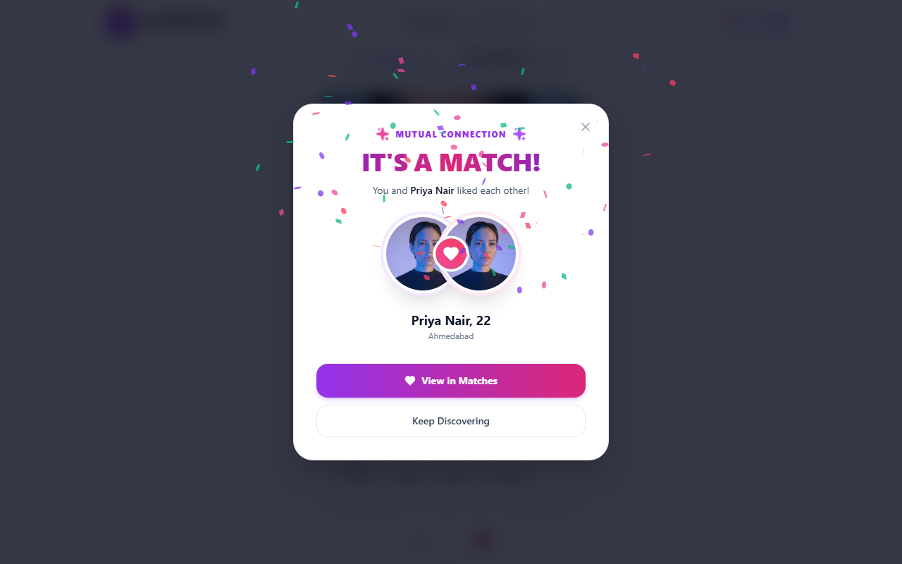
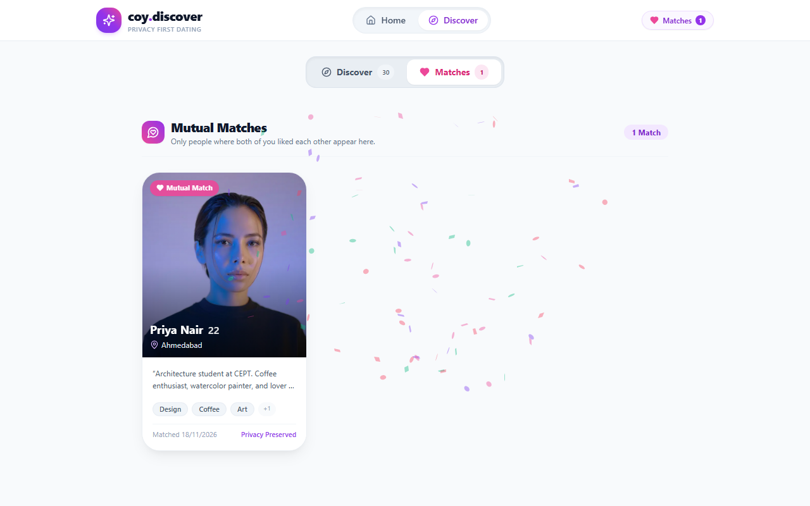
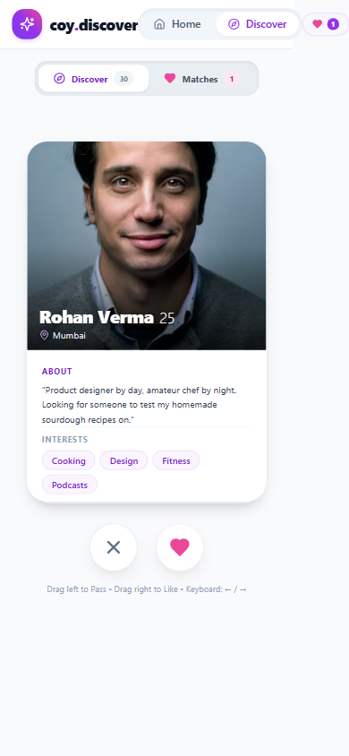

# Coy Discover

A modern, mobile-first profile discovery web application inspired by Tinder and Bumble, built as an SDE Intern technical assignment. Designed with an uncompromising focus on **privacy protection**, clean full-stack architecture, persistent MongoDB storage, physics-based gesture handling, and robust business logic.

---

## Overview

Coy Discover allows a logged-in demo user to discover unswiped user profiles, evaluate profiles with rich details, swipe using touch/mouse drag gestures, keyboard arrow shortcuts, or touch buttons, and experience instant celebratory matches when a mutual like occurs.

The application satisfies all assignment requirements:
- **Two Main Navigation Tabs**: **Home** (a simple blank placeholder per assignment specification) and **Discover** (where all discovery, swiping, and match browsing occurs).
- **Zero-Authentication Demo Mode**: Assumes a single logged-in user (`demo_user_001`) with complete session and refresh persistence.
- **Strict Privacy Guarantee**: A user who has liked the demo user is **never** revealed unless the demo user also explicitly likes that profile.
- **Full-Stack Persistence**: Every swipe and mutual match is persisted in MongoDB across page reloads and browser sessions, ensuring previously swiped profiles never return to the user's feed.

---

## Features

- **Gesture & Multi-Input Swiping**:
  - Drag gestures on touch and mouse devices powered by Framer Motion.
  - Keyboard controls (`ArrowRight` to Like, `ArrowLeft` to Pass).
  - Touch-friendly on-screen Like (💚) and Pass (❌) action buttons.
  - Dynamic visual stamps ("LIKE" in emerald and "NOPE" in rose) that respond during interaction.
- **Instant Mutual Match Celebration**:
  - Full-screen "It's a Match!" celebration modal with canvas confetti and dual avatar displays.
  - Modal is triggered **only** after verified backend confirmation.
- **Dedicated Mutual Matches View**:
  - Secondary tab in Discover allowing users to browse all confirmed mutual matches.
  - Displays match avatars, names, ages, cities, and timestamps.
- **Sticky, Mobile-First Navigation**:
  - Persistent sticky top navbar with active tab indicator and live matches counter badge.
  - Fully responsive across mobile (320px–430px), tablet (768px), and desktop (1024px–1440px+).
- **Caught-Up Empty State with One-Click Reset**:
  - Clean zero-state when all profiles in the feed have been swiped.
  - Includes a convenient "Reset Demo Swipes" button to facilitate rapid re-evaluation without terminal commands.
- **Single Active Card Display**:
  - Only one profile card is displayed and interactive at a time, backed by an underneath deck shadow card for depth.

---

## Tech Stack

| Layer | Technology | Purpose |
| :--- | :--- | :--- |
| **Frontend Framework** | **Next.js 14.2 (App Router)** | Server Components, Client Components, dynamic asset optimization |
| **UI Library** | **React 18.3** | Component lifecycle, custom hooks, reactive state management |
| **Language** | **TypeScript 5.7** | Strict end-to-end type safety across client, server, and database |
| **Styling** | **Tailwind CSS 3.4** | Utility-first responsive styling with custom color schemes and safe-area padding |
| **Animations** | **Framer Motion 11.15** | Physics-based card drag constraints, velocity thresholds, and presence exits |
| **Celebrations** | **Canvas Confetti 1.9** | Celebratory particle confetti when mutual matches are confirmed |
| **Icons** | **Lucide React 0.468** | Modern, accessible SVG icons |
| **Backend Runtime** | **Node.js (Next.js Route Handlers)** | Server-side REST endpoints with JSON response contracts |
| **Database & ODM** | **MongoDB & Mongoose 8.8** | Persistent document storage, schema validation, and compound unique indexing |
| **Testing Framework** | **Vitest 2.1 & MongoMemoryServer** | Fast automated unit and integration tests with in-memory database isolation |

---

## Screenshots

| Discover Feed | Swipe Experience |
| :---: | :---: |
|  |  |

| Mutual Match Modal | Matches Grid |
| :---: | :---: |
|  |  |

| Mobile Viewport |
| :---: |
|  |

---

## Architecture

The project adheres to a clean separation of concerns between presentation, routing, domain business logic, and database persistence.

```text
coy-discover/
├── app/                           # Next.js App Router
│   ├── api/                       # Backend REST Route Handlers
│   │   ├── feed/route.ts          # GET /api/feed (excludes swiped, strips likedCurrentUser)
│   │   ├── swipe/route.ts         # POST /api/swipe (records swipe, evaluates match)
│   │   ├── matches/route.ts       # GET /api/matches (returns mutual matches)
│   │   └── reset/route.ts         # POST /api/reset (clears demo user history)
│   ├── discover/page.tsx          # Discover & Matches screen (card deck, gestures, modal)
│   ├── globals.css                # Global CSS directives and utility classes
│   ├── layout.tsx                 # Root layout shell with sticky navigation wrapper
│   └── page.tsx                   # Home tab (blank placeholder per assignment spec)
├── components/                    # Reusable React UI Components
│   ├── EmptyState.tsx             # Zero-state when feed is exhausted
│   ├── LoadingState.tsx           # Skeleton loading state
│   ├── MatchesList.tsx            # Grid display of confirmed mutual matches
│   ├── MatchModal.tsx             # "It's a Match!" celebration modal with confetti
│   ├── Navbar.tsx                 # Sticky navigation header with match counter
│   ├── ProfileCard.tsx            # Profile card layout with photo, bio, and stamps
│   └── SwipeButtons.tsx           # Like and Pass action buttons
├── lib/                           # Core Business Logic & Shared Utilities
│   ├── constants.ts               # Demo user constants and fallback assets
│   ├── mongodb.ts                 # Cached Mongoose connection helper for Next.js
│   └── swipeService.ts            # Domain matching engine, feed filter, and privacy rules
├── models/                        # Mongoose Schemas & Database Models
│   ├── Match.ts                   # Match schema with compound unique index
│   ├── Profile.ts                 # Profile schema with select:false on likedCurrentUser
│   └── Swipe.ts                   # Swipe schema with compound unique index
├── public/                        # Static assets and screenshot assets
├── screenshots/                   # Application screenshots for repository documentation
├── scripts/                       # Database Seeding & Verification Scripts
│   ├── mockProfiles.ts            # 32 unique Indian mock profiles with realistic data
│   ├── seed.ts                    # Database seed execution script
│   ├── verifyFrontendE2E.ts       # Automated UI test script
│   ├── verifyLikeMatchE2E.ts      # Automated Like/Match verification script
│   ├── verifyResponsive.ts        # Multi-viewport responsive audit script
│   └── verifyStickyNav.ts         # Sticky navigation verification script
├── tests/                         # Vitest Automated Test Suites
│   ├── apiRoutes.test.ts          # API Route Handler integration tests
│   ├── consecutiveSwipeScenarios.test.ts # Edge case & concurrency test suite
│   └── swipeService.test.ts       # Business logic & privacy unit tests
├── types/                         # TypeScript Interface Definitions
│   └── index.ts                   # Core domain types and API contracts
├── .env.example                   # Environment variable template
├── package.json                   # NPM configuration and dependencies
├── tailwind.config.ts             # Tailwind configuration
├── tsconfig.json                  # TypeScript configuration
└── vitest.config.ts               # Vitest runner configuration
```

---

## API Endpoints

All route handlers are strictly typed and located under `app/api/`.

### 1. `GET /api/feed`
Retrieves discovery feed profiles that the current user has not yet swiped on.

- **Headers**:
  - `x-user-id` *(optional)*: User identifier (defaults to `demo_user_001`).
- **Response `(200 OK)`**:
  ```json
  {
    "success": true,
    "profiles": [
      {
        "id": "6afc989594a8684690b030cd",
        "name": "Aarav Sharma",
        "age": 26,
        "photo": "https://images.unsplash.com/...",
        "bio": "Product designer who loves trekking and specialty coffee.",
        "city": "Mumbai",
        "interests": ["Design", "Trekking", "Coffee", "Photography"]
      }
    ]
  }
  ```
- **Privacy Enforcement**: `likedCurrentUser` is completely stripped by the query projection and sanitization layer.

---

### 2. `POST /api/swipe`
Records a user swipe (`like` or `pass`), validates against duplicate submissions, and evaluates mutual matching conditions.

- **Headers**:
  - `x-user-id` *(optional)*: User identifier (defaults to `demo_user_001`).
  - `x-request-id` *(optional)*: Tracing identifier for end-to-end request tracking.
- **Request Body**:
  ```json
  {
    "profileId": "6afc989594a8684690b030cd",
    "action": "like"
  }
  ```
- **Response `(200 OK - Mutual Match)`**:
  ```json
  {
    "success": true,
    "isMatch": true,
    "match": {
      "id": "6b002a4fccad272c2cbd24cc",
      "profile": {
        "id": "6afc989594a8684690b030cd",
        "name": "Aarav Sharma",
        "age": 26,
        "photo": "https://images.unsplash.com/...",
        "city": "Mumbai",
        "bio": "Product designer who loves trekking and specialty coffee."
      }
    }
  }
  ```
- **Response `(200 OK - No Match / Pass)`**:
  ```json
  {
    "success": true,
    "isMatch": false
  }
  ```
- **Response `(409 Conflict - Duplicate Swipe)`**:
  ```json
  {
    "success": false,
    "error": "This profile has already been swiped on"
  }
  ```

---

### 3. `GET /api/matches`
Returns all confirmed mutual matches for the acting user.

- **Headers**:
  - `x-user-id` *(optional)*: User identifier (defaults to `demo_user_001`).
- **Response `(200 OK)`**:
  ```json
  {
    "success": true,
    "matches": [
      {
        "id": "6b002a4fccad272c2cbd24cc",
        "userId": "demo_user_001",
        "profileId": "6afc989594a8684690b030cd",
        "createdAt": "2026-11-20T11:09:03.792Z",
        "profile": {
          "id": "6afc989594a8684690b030cd",
          "name": "Aarav Sharma",
          "age": 26,
          "photo": "https://images.unsplash.com/...",
          "bio": "Product designer who loves trekking and specialty coffee.",
          "city": "Mumbai",
          "interests": ["Design", "Trekking", "Coffee", "Photography"]
        }
      }
    ]
  }
  ```

---

### 4. `POST /api/reset`
Clears swipe history and mutual matches for the demo user without modifying the seeded profile catalog, allowing reviewers to restart testing cleanly.

- **Response `(200 OK)`**:
  ```json
  {
    "success": true,
    "message": "Demo user history reset successfully"
  }
  ```

---

## Installation

### Prerequisites
- **Node.js**: v18.17.0 or higher (v20+ recommended)
- **MongoDB**: Local MongoDB instance (running on port `27017`) or a free [MongoDB Atlas](https://www.mongodb.com/atlas) cluster URI.
- **Git**

### Step-by-Step Setup

1. **Clone the repository**:
   ```bash
   git clone https://github.com/dhruv-yadav-49/coy-discover.git
   cd coy-discover
   ```

2. **Install project dependencies**:
   ```bash
   npm install
   ```

3. **Configure Environment Variables**:
   Copy the example environment file:
   ```bash
   cp .env.example .env.local
   ```
   *(On Windows PowerShell: `Copy-Item .env.example .env.local`)*

---

## Environment Variables

Configure `.env.local` in the project root:

```env
# MongoDB Connection String
# Local MongoDB:
MONGODB_URI=mongodb://127.0.0.1:27017/coy_discover

# Or MongoDB Atlas:
# MONGODB_URI=mongodb+srv://<username>:<password>@cluster.mongodb.net/coy_discover?retryWrites=true&w=majority

# Demo User ID (assumed single logged-in user per assignment specification)
DEMO_USER_ID=demo_user_001
```

> **Security Note**: `.env.local` is listed in `.gitignore` and must never be committed to public version control.

---

## Running the Project

The available commands defined in `package.json` are:

| Script | Command | Description |
| :--- | :--- | :--- |
| `seed` | `npm run seed` | Seeds 32 unique Indian mock profiles into MongoDB |
| `dev` | `npm run dev` | Starts the Next.js development server at `http://localhost:3000` |
| `build` | `npm run build` | Compiles the production-optimized Next.js build |
| `start` | `npm run start` | Runs the compiled production server |
| `lint` | `npm run lint` | Runs ESLint static analysis |
| `test` | `npm test` | Runs the full Vitest automated test suite |

### Standard Startup Flow

1. **Seed the database with mock profiles**:
   ```bash
   npm run seed
   ```
   *To reset swipe history while seeding, run:*
   ```bash
   npm run seed -- --reset-demo
   ```

2. **Start the development server**:
   ```bash
   npm run dev
   ```

3. **Open the application**:
   Open [http://localhost:3000](http://localhost:3000) in your browser. Navigate to the **Discover** tab to begin swiping.

---

## Running Tests

Automated testing is configured using **Vitest** with **MongoMemoryServer** for isolated, zero-side-effect test runs.

Run the entire test suite:
```bash
npm test
```

### Test Coverage Summary (20 / 20 Tests Passing)

1. **`tests/swipeService.test.ts` (8 Tests)**:
   - Validates like and pass storage in the `swipes` collection.
   - Confirms mutual match creation when `likedCurrentUser === true`.
   - Ensures no match is created on pass, even if the other profile liked the user.
   - Guarantees `likedCurrentUser` remains completely hidden.
   - Rejects duplicate swipes on the same profile with status 409.
   - Verifies empty array return when all profiles have been swiped.

2. **`tests/consecutiveSwipeScenarios.test.ts` (6 Tests)**:
   - Consecutive non-mutual likes (profiles that haven't liked the user).
   - Consecutive mutual likes (back-to-back matches).
   - Non-alternating independent profile processing.
   - Concurrency protection: rapid simultaneous clicks rejected cleanly.
   - Mixed action sequence: Like followed by Pass.
   - Refresh persistence across simulated page reloads.

3. **`tests/apiRoutes.test.ts` (6 Tests)**:
   - End-to-end integration tests for `GET /api/feed`.
   - End-to-end integration tests for `POST /api/swipe`.
   - Duplicate rejection via HTTP status 409.
   - End-to-end integration tests for `GET /api/matches`.
   - End-to-end integration tests for `POST /api/reset`.

---

## Matching Logic

The matching engine is strictly server-driven and implemented in `lib/swipeService.ts`:

$$\text{isMutualMatch} = (\text{action} == \text{"like"}) \land (\text{profile.likedCurrentUser} == \text{true})$$

```typescript
// 1. Fetch target profile with internal flag
const profile = await Profile.findById(cleanProfileId).select("+likedCurrentUser");

// 2. Prevent duplicate swipes
const existingSwipe = await Swipe.findOne({ userId: cleanUserId, profileId: profile._id });
if (existingSwipe) {
  throw new ValidationError("This profile has already been swiped on", 409);
}

// 3. Persist the swipe record
await Swipe.create({
  userId: cleanUserId,
  profileId: profile._id,
  action: normalizedAction,
});

// 4. Evaluate mutual match condition
const isMutualMatch = normalizedAction === "like" && profile.likedCurrentUser === true;

// 5. If mutual, atomically record match
if (isMutualMatch) {
  await Match.findOneAndUpdate(
    { userId: cleanUserId, profileId: profile._id },
    { $setOnInsert: { userId: cleanUserId, profileId: profile._id, createdAt: new Date() } },
    { upsert: true, new: true }
  );
}
```

### Business Rules Enforced
1. **Pass Action**: If the user passes (`action === "pass"`), no match is created under any circumstances, even if `likedCurrentUser === true`.
2. **One-Way Like**: If the user likes (`action === "like"`) but `likedCurrentUser === false`, the swipe is saved, but no match is created.
3. **Mutual Like**: A match is created **only** when both users like each other.
4. **Idempotence**: Database compound indices `{ userId: 1, profileId: 1 }` on both `swipes` and `matches` guarantee that duplicate swipes or duplicate matches can never be created, even under concurrent network requests.

---

## Privacy Considerations

Privacy protection is the most critical business requirement of Coy Discover:

1. **Schema-Level Field Protection**:
   In `models/Profile.ts`, the `likedCurrentUser` boolean attribute is defined with `select: false`. Standard database queries (`Profile.find()`, `Profile.findById()`) will never include this field unless explicitly overridden via `.select("+likedCurrentUser")` inside internal backend service functions.

2. **Data Sanitization Layer**:
   Before sending any profile data to the client, documents pass through `sanitizeProfile()` in `lib/swipeService.ts`. This strictly projects only safe, public fields:
   ```typescript
   export function sanitizeProfile(profile: IProfileDocument | Record<string, unknown>): PublicProfile {
     return {
       id: doc._id.toString(),
       name: doc.name,
       age: doc.age,
       photo: doc.photo,
       bio: doc.bio,
       city: doc.city,
       interests: doc.interests || [],
     };
   }
   ```

3. **Zero Frontend Guessing**:
   The frontend possesses **zero awareness** of incoming likes before a swipe occurs. Match detection is never computed in the browser; the client displays the celebration modal only when the backend explicitly responds with `{ isMatch: true }`.

4. **Passed Profiles Kept Confidential**:
   When a user passes a profile that secretly liked them, the pass is recorded, the profile is excluded from future discovery, and the incoming like remains permanently confidential.
